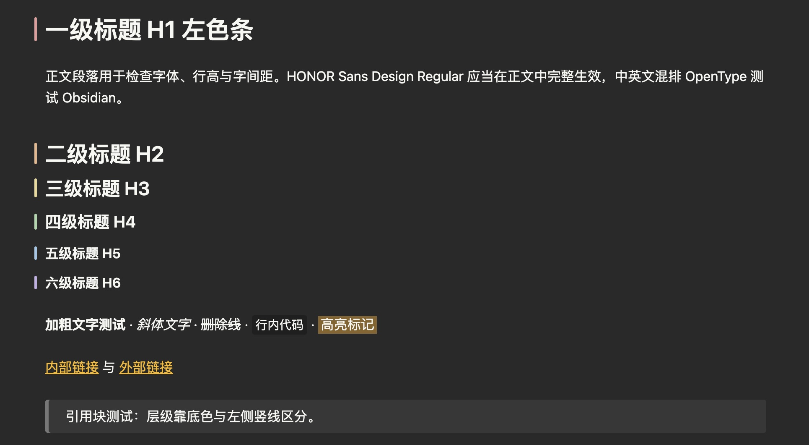
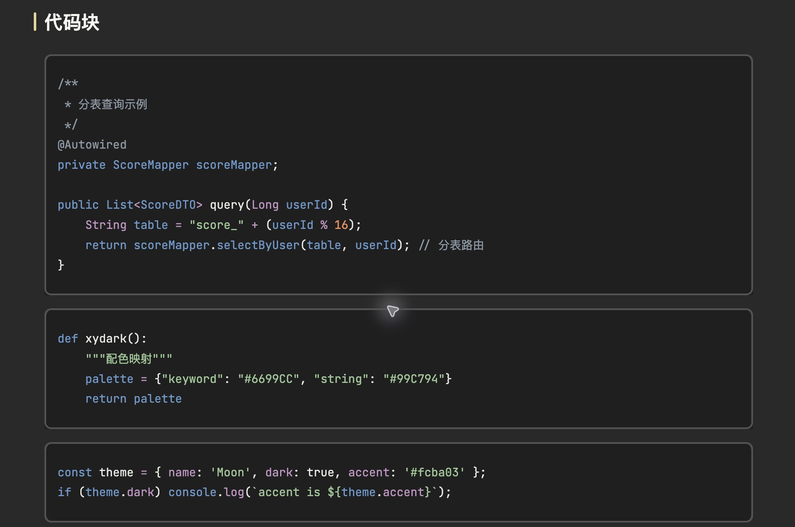

# Moon for Obsidian

[简体中文](README.zh-CN.md) · English

A dark Obsidian theme adapted toward the look of Typora’s Moon theme, with carefully styled Markdown and a warm yellow accent.



*Captured in Obsidian 1.14.5 using the theme preview note.*

## Highlights

- Dark writing surface with colored heading markers and yellow links.
- Styled blockquotes, tables, task lists, callouts and horizontal rules.
- Bordered code blocks with language highlighting and Mermaid diagram styling.
- Hides folders ending in `.assets` in the file explorer; the files remain available to notes.
- Includes a preview note for checking common Markdown elements.



## Installation

Requires Obsidian 1.4.0 or later, as specified in the theme manifest. The screenshots were captured in Obsidian 1.14.5; other versions and configurations may render differently.

1. Download or clone this repository.
2. Copy the entire `Moon` folder into your vault’s `.obsidian/themes/` directory, so `theme.css` and `manifest.json` are directly inside `.obsidian/themes/Moon/`.
3. In Obsidian, open **Settings → Appearance → Themes** and select **Moon**. Use dark mode for the appearance shown above.
4. Optionally copy [the preview note](docs/theme-preview.md) into your vault and open it to inspect the styles.

## Structure

```text
Moon/
  theme.css        Theme styles
  manifest.json    Obsidian theme metadata
  fonts/           Bundled font asset
docs/
  theme-preview.md
  screenshots/     Obsidian screenshots
```

## Notes

- This is a visual adaptation, not a guarantee of pixel-identical rendering across applications, fonts, zoom levels or Obsidian versions.
- The CSS retains attribution to Notation 2 by Ha’ani Whitlock, based on Notation by deathau, and references Typora Moon. Third-party font and theme assets may have their own terms; no project-wide license is currently specified.
- Edit `Moon/theme.css` to customize the theme. Reload or reselect the theme in Obsidian to inspect changes.
- Issues and pull requests are welcome. Include your Obsidian version, operating system and a screenshot when reporting visual problems.
