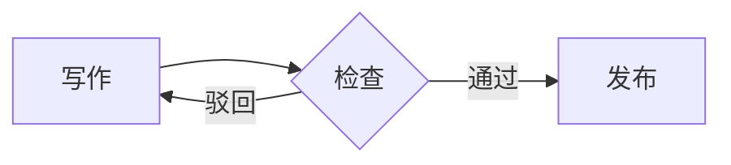

# 一级标题 H1 左色条

正文段落用于检查字体、行高与字间距。HONOR Sans Design Regular 应当在正文中完整生效，中英文混排 OpenType 测试 Obsidian。

## 二级标题 H2
### 三级标题 H3
#### 四级标题 H4
##### 五级标题 H5
###### 六级标题 H6

**加粗文字测试** · *斜体文字* · ~~删除线~~ · `行内代码` · ==高亮标记==

[内部链接](#二级标题-h2) 与 [外部链接](https://obsidian.md)

>引用块测试：层级靠底色与左侧竖线区分。

### 表格

| 项目   | 配色        | 用途   |
| ---- | --------- | ---- |
| Moon | `#fcba03` | 暗色主色 |
| Sun  | `#b58900` | 亮色主色 |
| 正文   | `#f8f8f2` | 文字   |

### 任务列表

- [x] 已完成项目
- [ ] 未完成项目
- [ ] 第三项

### 代码块

```java
/**
 * 分表查询示例
 */
@Autowired
private ScoreMapper scoreMapper;

public List<ScoreDTO> query(Long userId) {
    String table = "score_" + (userId % 16);
    return scoreMapper.selectByUser(table, userId); // 分表路由
}
```
```python
def xydark():
    """配色映射"""
    palette = {"keyword": "#6699CC", "string": "#99C794"}
    return palette
```
```javascript
const theme = { name: 'Moon', dark: true, accent: '#fcba03' };
if (theme.dark) console.log(`accent is ${theme.accent}`);
```

### Callout

> [!tip] 提示
> Callout 容器圆角与左边框。

### Mermaid


### 脚注

正文提到一个脚注[^1]。

[^1]: 脚注内容示例。

---
